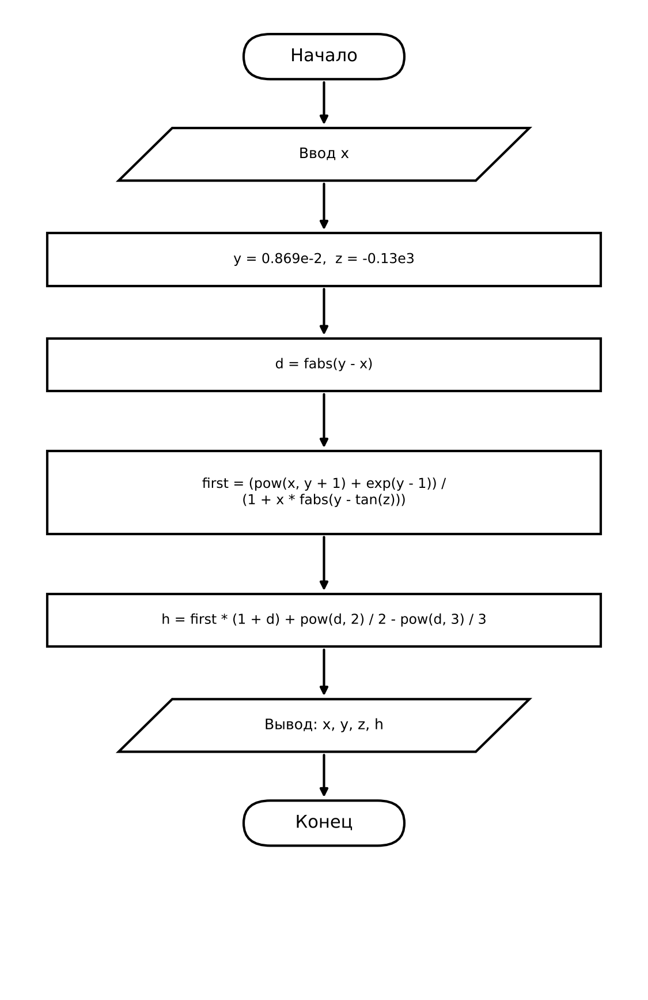

# Домашнее задание к работе 5

## Условие задачи (Вариант 15)

Вычислить значение выражения при заданных значениях параметров:

- `x = 2.444`
- `y = 0.869e-2`
- `z = -0.13e3`

Формула вычисления:

```
h = (x^(y+1) + e^(y-1)) / (1 + x * |y - tg(z)|) * (1 + |y - x|) + |y - x|^2 / 2 - |y - x|^3 / 3
```

Контрольный результат: `h = -0.49871`.

Вывести на экран значения параметров и полученный результат вычисления `h`.

* * *

## 1. Алгоритм и блок-схема

### Алгоритм

1. Задать значения параметров: `y = 0.869e-2`, `z = -0.13e3`; значение `x` ввести с клавиатуры (контрольное значение `x = 2.444`).
2. Найти модуль разности: `d = fabs(y - x)`.
3. Вычислить первое слагаемое: `first = (pow(x, y + 1) + exp(y - 1)) / (1 + x * fabs(y - tan(z)))`.
4. Найти результат: `h = first * (1 + d) + pow(d, 2) / 2 - pow(d, 3) / 3`.
5. Вывести на экран значения переменных `x`, `y`, `z` и значение функции `h`.
6. Завершить работу программы.

### Блок-схема



* * *

## 2. Реализация программы

Исходный код программы: [Source.c](Source.c)

* * *

## 3. Результаты работы программы

Пример работы программы:

```
Введите x: 2.444

x = 2.444
y = 0.00869
z = -130
h = -0.49871
```

* * *

## 4. Информация о разработчике

- **ФИО:** Гуменников Степан Станиславович
- **Группа:** БОТИ-262
